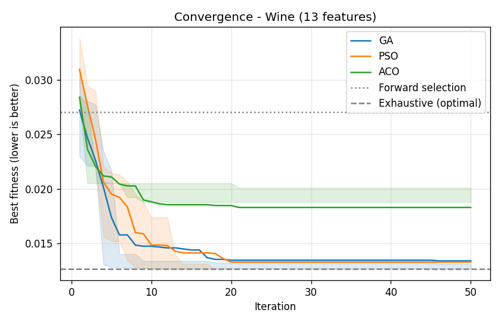
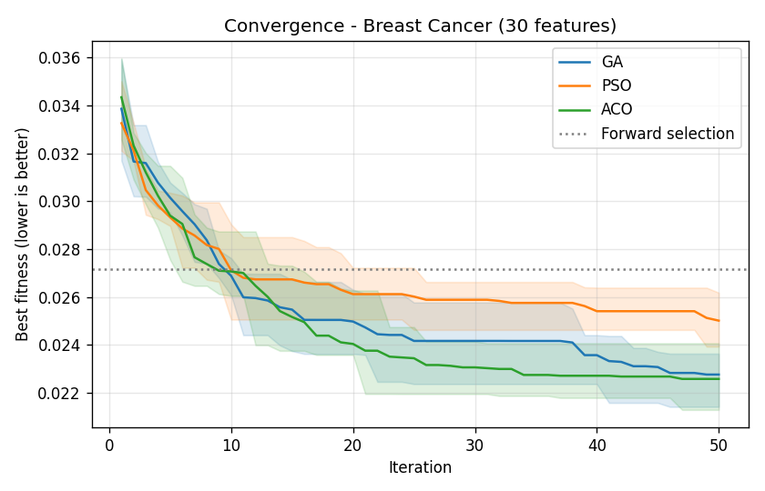
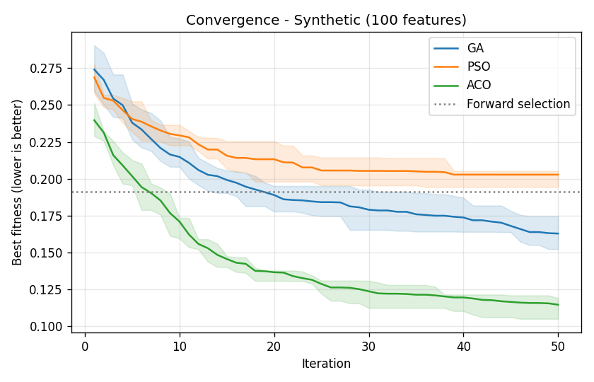
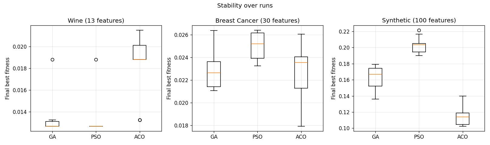
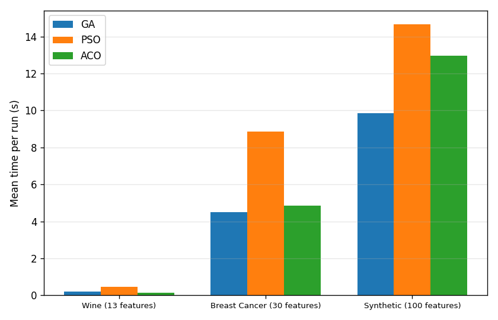
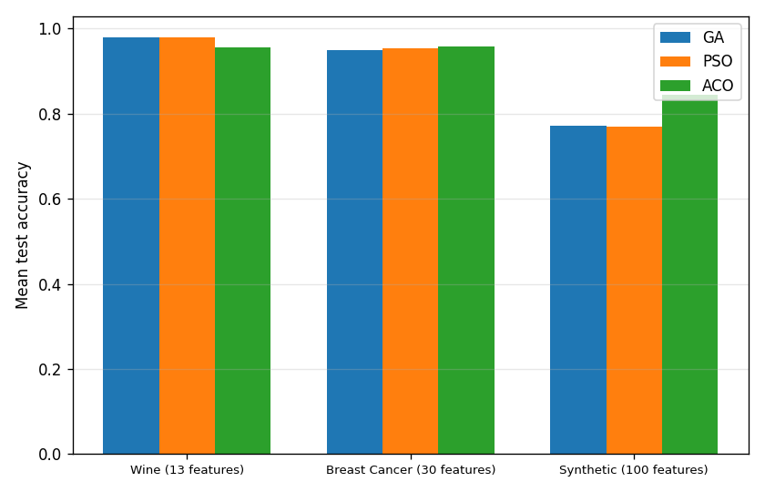

# Feature Selection using GA, PSO and ACO

## 1. The problem

A dataset often has features that are useless or repeat each other. They slow the
model down and can even make it less accurate. **Feature selection** means picking a
subset of the features that keeps the accuracy high while using as few features as
possible.

With `n` features there are `2^n - 1` possible subsets (13 features → 8,191,
30 features → about 1 billion, 100 features → about 10^30). We can't try them all
except for very small `n`, so we use metaheuristics.

The classifier we use to judge a subset is **KNN (k = 5)**. It is simple, and it
is sensitive to bad features, so feature selection really makes a difference for it.

## 2. Modeling

### Solution representation
A solution is a binary vector of length `n`:

```
features:  f0 f1 f2 f3 f4 f5 ... f12
solution:   1  0  1  1  0  0 ...  1     -> use f0, f2, f3, ..., f12
```

All three algorithms work directly on this vector (PSO uses a sigmoid to get from
real valued velocities to bits, ACO builds the vector bit by bit).

### Fitness function (minimized)

```
fitness = 0.99 * error_rate + 0.01 * (selected_features / total_features)
```

- `error_rate` = mean error of KNN in 3-fold cross validation on the **training set**.
- The second term breaks ties in favour of smaller subsets. Accuracy matters much
  more (weight 0.99), so the algorithms will not drop a feature that helps.
- An empty subset gets fitness 1 (the worst value).

The data is split 70% train / 30% test before anything else. The test set is only
used at the end to report the accuracy of the final subset, never during the search.

To keep the experiments fast, KNN distances are prepared once per fold
(squared difference per feature), so the distance for any subset is one matrix
multiplication. Fitness values are also cached, so the same subset is never
evaluated twice in one run.

## 3. Algorithms

All three use the same budget: **20 individuals × 50 iterations**.
The stopping criterion is the number of iterations (50) for all of them, so the
comparison is fair.

### 3.1 Genetic Algorithm (GA)
1. Start with 20 random bit vectors.
2. **Selection**: tournament of size 3 (pick 3 at random, keep the best).
3. **Crossover**: one-point crossover with probability 0.9.
4. **Mutation**: each bit flips with probability `1/n`.
5. **Elitism**: the 2 best individuals go to the next generation unchanged.

### 3.2 Binary Particle Swarm Optimization (PSO)
Each particle has a position (bit vector) and a velocity (real vector).

```
v = w*v + c1*r1*(pbest - x) + c2*r2*(gbest - x)
x_i = 1 if random() < sigmoid(v_i) else 0
```

- `w` decreases linearly from 0.9 to 0.4 (explore at the start, exploit at the end).
- `c1 = c2 = 2`, velocity clipped to `[-4, 4]`.

### 3.3 Ant Colony Optimization (ACO)
Every feature has two pheromone values: `tau_on` (take it) and `tau_off` (leave it).
Each ant decides for each feature with probability

```
p_take = tau_on * eta / (tau_on * eta + tau_off * (1 - eta))
```

- `eta` is the heuristic information: the **mutual information** between the
  feature and the class, scaled to `[0.1, 0.9]`. So ants prefer features that
  look useful on their own.
- After each iteration the pheromone evaporates (`rho = 0.2`) and the best ant found
  so far reinforces its decisions with `quality = 1 - fitness`.
- Pheromone is kept in `[0.05, 1]` so no probability becomes exactly 0 or 1
  (avoids getting stuck too early, like in Max-Min Ant System).

### 3.4 Hyperparameters

| algorithm | parameter | value |
|---|---|---|
| all | population / swarm / colony size | 20 |
| all | iterations (stopping criterion) | 50 |
| GA | crossover rate | 0.9 |
| GA | mutation rate | 1/n |
| GA | tournament size / elites | 3 / 2 |
| PSO | w (inertia) | 0.9 → 0.4 |
| PSO | c1, c2 | 2, 2 |
| PSO | v_max | 4 |
| ACO | alpha, beta | 1, 1 |
| ACO | evaporation rho | 0.2 |
| ACO | pheromone limits | [0.05, 1] |

## 4. Baselines

- **All features**: no selection at all.
- **Forward selection (greedy)**: start empty, add the one feature that improves
  the fitness the most, stop when no feature improves it.
- **Exhaustive search**: tries all 8,191 subsets. Only possible on the small
  dataset, but it gives the **true optimum**, so we can see how close the
  metaheuristics get.

**Why not Dynamic Programming?** DP needs the problem to split into independent
subproblems (optimal substructure). Here the value of a feature depends on which
other features are already chosen (two features can be useless alone and good
together, or two can be copies of each other). So the best subset of size `k` can't
be built from the best subset of size `k-1`. Exhaustive search plays the role of an
exact baseline instead.

## 5. Experimental setup

| size | dataset | samples | features | classes |
|---|---|---|---|---|
| Small | Wine | 178 | 13 | 3 |
| Medium | Breast Cancer Wisconsin | 569 | 30 | 2 |
| Large | Synthetic (`make_classification`: 15 informative, 10 redundant, 75 noise) | 600 | 100 | 2 |

- Each metaheuristic was run **10 times** on each dataset (seeds 0–9).
- Measured: final fitness (best / mean / std / worst), test accuracy, number of
  selected features, time per run, number of fitness evaluations, and the
  iteration where the final best was first reached (convergence speed).
- Machine: laptop, Windows 11, Python 3.14, numpy limited to one thread.
  The laptop's speed changed a lot during the day (the same run took 2 s once and
  9 s later), so for each seed the three algorithms are run back to back to make the
  comparison fair. The number of fitness evaluations does not depend on the machine
  at all, so it is the more reliable cost measure; the times follow it closely.

## 6. Results

Lower fitness is better. "Iter. to best" = iteration where the final best was
first found (out of 50). Test acc. = accuracy on the 30% test set.
"Evaluations" = number of different subsets that were actually evaluated
(repeated subsets come from the cache for free).

### 6.1 Small – Wine (13 features)

| algorithm | best | mean ± std | worst | test acc. | # features | evaluations | time (s) | iter. to best |
|---|---|---|---|---|---|---|---|---|
| GA | 0.0127 | 0.0134 ± 0.0019 | 0.0188 | 0.980 | 6.0 | 298 | 0.20 | 12.5 |
| PSO | 0.0127 | 0.0133 ± 0.0019 | 0.0188 | 0.980 | 5.8 | 779 | 0.47 | 12.6 |
| ACO | 0.0132 | 0.0183 ± 0.0028 | 0.0215 | 0.956 | 5.3 | 148 | 0.14 | 9.3 |
| All features | 0.0499 | – | – | 0.944 | 13 | 1 | – | – |
| Forward selection | 0.0270 | – | – | 0.907 | 4 | 55 | 0.01 | – |
| Exhaustive (optimal) | **0.0127** | – | – | 0.981 | 6 | 8191 | 1.66 | – |

The optimum is found by GA in **7/10** runs, by PSO in **9/10** runs, and by ACO
in **0/10** runs (ACO's best was very close: 0.0132).



### 6.2 Medium – Breast Cancer (30 features)

| algorithm | best | mean ± std | worst | test acc. | # features | evaluations | time (s) | iter. to best |
|---|---|---|---|---|---|---|---|---|
| GA | 0.0211 | 0.0228 ± 0.0017 | 0.0264 | 0.949 | 12.3 | 500 | 4.49 | 27.6 |
| PSO | 0.0233 | 0.0250 ± 0.0012 | 0.0264 | 0.953 | 14.6 | 1020 | 8.85 | 26.6 |
| ACO | **0.0179** | **0.0226 ± 0.0027** | 0.0261 | 0.957 | 11.0 | 509 | 4.84 | 30.5 |
| All features | 0.0498 | – | – | 0.959 | 30 | 1 | – | – |
| Forward selection | 0.0272 | – | – | 0.930 | 7 | 212 | 1.84 | – |



### 6.3 Large – Synthetic (100 features)

| algorithm | best | mean ± std | worst | test acc. | # features | evaluations | time (s) | iter. to best |
|---|---|---|---|---|---|---|---|---|
| GA | 0.1361 | 0.1627 ± 0.0148 | 0.1792 | 0.772 | 45.8 | 654 | 9.84 | 45.1 |
| PSO | 0.1899 | 0.2027 ± 0.0103 | 0.2214 | 0.769 | 45.0 | 1020 | 14.66 | 27.9 |
| ACO | **0.1026** | **0.1144 ± 0.0114** | 0.1399 | **0.844** | 10.3 | 825 | 12.97 | 41.2 |
| All features | 0.3046 | – | – | 0.739 | 100 | 1 | – | – |
| Forward selection | 0.1913 | – | – | 0.650 | 4 | 490 | 8.54 | – |



### 6.4 Stability and time







## 7. Discussion

**All three beat the baselines on fitness.** On every dataset each metaheuristic
gets a lower fitness than both "all features" and greedy forward selection. Forward
selection is fast but stops at the first local optimum: it adds 4 features on Wine and
then no single feature helps anymore, even though the optimal subset has 6.

**GA**
- Strong: very reliable on the small problem (reached the optimum 7/10 times), and
  the fastest metaheuristic on medium and large: elitism and crossover create many
  repeated subsets, so it needs fewer real evaluations (500 vs 1020 for PSO on medium).
  On the large problem it was still improving at iteration 50 (iter. to best ≈ 45), so
  it would do better with more iterations.
- Weak: starts from random vectors with ~50% of the features and mutation only flips
  1 bit on average, so on 100 features it removes the useless ones slowly
  (still ~46 features at the end).

**PSO**
- Strong: best on the small problem (optimum in 9/10 runs, lowest mean fitness).
- Weak: the worst of the three on medium and large. Binary PSO with a sigmoid keeps
  every bit somewhat random even when the velocity is high, so it can't fine-tune a
  good solution well. On the large problem it stopped improving around iteration 28
  while still using ~45 features.
  It also did the most fitness evaluations (1020 = every particle is new every
  iteration), so it was the slowest on every dataset.

**ACO**
- Strong: clearly the best on the large problem (fitness 0.114 vs 0.163 for GA,
  only ~10 features, test accuracy 84% vs 77%), and best on medium too. The reason is
  the heuristic `eta` (mutual information): ants are pushed toward useful features from
  the first iteration, which matters a lot when 75 of 100 features are noise.
- Weak: on the small problem it never found the exact optimum. The heuristic is based
  on each feature *alone*, so it can push the search away from a feature that is only
  useful together with others. It also converges quickly (≈9 iterations on Wine) and
  then stays there.

**Overfitting the fitness.** On Breast Cancer, using all features gives a slightly higher
*test* accuracy (0.959) than the selected subsets (0.949–0.957), even though the
selected subsets are clearly better in cross validation (≈0.98 vs 0.96). With only
~400 training samples, searching thousands of subsets finds some that are "lucky" on
the 3 CV folds. Still, the selected subsets use 11–15 features instead of 30 with almost
the same accuracy. On the large dataset, where most features are noise, selection
helps the test accuracy a lot (ACO 0.844 vs 0.739).

**Problem size.** On 13 features all methods are close and GA/PSO find the true optimum
in under 0.5 s (exhaustive search needs 8,191 evaluations, and that number doubles
with every extra feature). As the size grows
the gap between the algorithms grows: the search space is huge and a good guide
(ACO's heuristic) or more iterations (GA) are needed.

## 8. Conclusion

- For a **small** number of features, GA or PSO are enough and find the optimum almost
  every time.
- For **many features with a lot of noise**, ACO with a mutual information heuristic was
  the best in quality, number of features and test accuracy.
- GA was the best "all round" choice among the methods without heuristic information,
  and was still improving on the large problem.
- Possible improvements: start GA/PSO with fewer features selected, use more iterations
  on large problems, and use more CV folds (or a separate validation set) to reduce
  overfitting of the fitness.

## How to reproduce

```
pip install -r requirements.txt
python main.py
```

All the numbers and figures above are produced in the `results/` folder.
